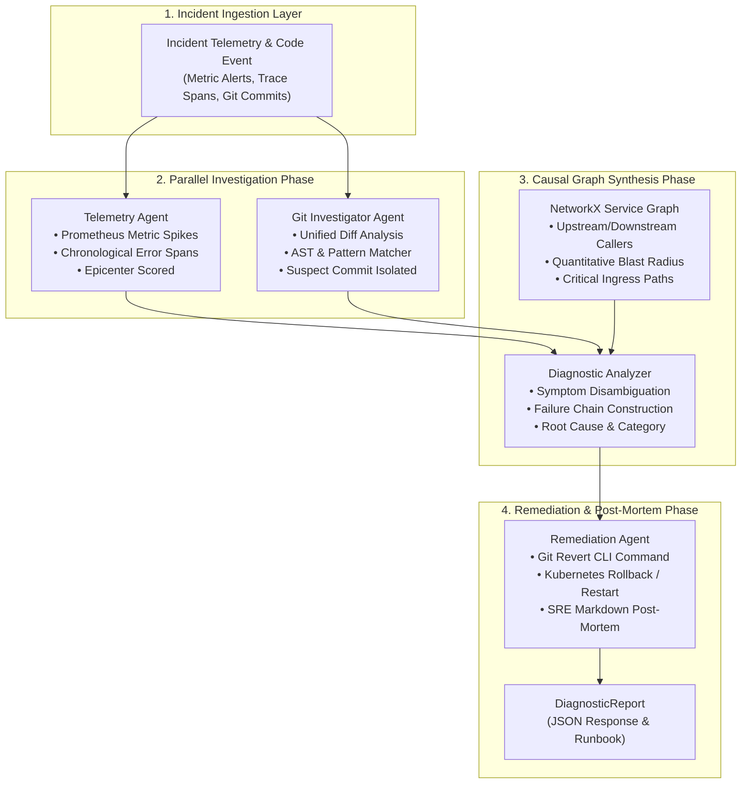

# AegisSRE: Autonomous Multi-Agent SRE Incident Root-Cause Engine

[](#testing)
[](#verified-benchmark-results)
[](#verified-benchmark-results)
[](#tech-stack)
[](#api-reference)
[](#simulation-layer)

**AegisSRE** is a production-grade autonomous Site Reliability Engineering (SRE) multi-agent incident root-cause diagnosis engine. It continuously correlates distributed system telemetry (Prometheus metric spikes, distributed tracing spans) and Git commit diffs against a NetworkX Service Dependency Graph to pinpoint failure epicenters, calculate blast radius, and generate actionable markdown post-mortems with one-click rollback commands.

---

## Architecture & Multi-Agent DAG Workflow

AegisSRE models incident resolution as a directed acyclic graph (DAG) workflow operating on a shared `IncidentState`.

### Multi-Agent Pipeline Flowchart



### Agent Responsibilities
1. **Telemetry Agent** (`src/agents/telemetry_agent.py`):
   - Ingests Prometheus metric alerts (5xx rates, connection pool metrics, memory saturation, latency spikes).
   - Parses distributed trace spans to isolate the earliest failure timestamp and distinct error signatures.
   - Calculates the telemetry failure epicenter score.
2. **Git Investigator** (`src/agents/git_agent.py`):
   - Inspects recent commit messages, file paths, and unified diffs.
   - Detects risky patterns (pool size drops, unevicted static collections, unbounded memory leaks, synchronous JWKS remote calls, port typos).
   - Computes commit regression confidence and maps the culprit service.
3. **Diagnostic Analyzer** (`src/agents/diagnostic_agent.py`):
   - Synthesizes telemetry signals, git regressions, and the NetworkX service dependency graph.
   - Disambiguates symptoms (e.g., `edge-gateway` 503s) from actual failure origins (e.g., `order-service` pool exhaustion or `auth-service` timeout).
   - Computes topological blast radius, affected tiers, and builds a step-by-step causal failure propagation chain.
4. **Remediation Agent** (`src/agents/remediation_agent.py`):
   - Generates production-safe mitigation and rollback commands (`git revert`, `kubectl rollout restart`).
   - Produces configuration hotfix snippets.
   - Outputs an industry-standard Markdown SRE Post-Mortem.

---

## Verified Benchmark Results

The multi-agent diagnosis engine was benchmarked across **50 synthetic incident scenarios** in deterministic simulation mode (`SIMULATION_MODE=true`). Full metrics are persisted in [`benchmarks/benchmark_results.json`](benchmarks/benchmark_results.json):

### Summary Metrics
| Metric | Result | Benchmark Target | Status |
| :--- | :--- | :--- | :--- |
| **Total Scenarios Evaluated** | **50** | 50 scenarios | Verified |
| **Root Cause Service Accuracy** | **100.0%** (50/50) | >= 90.0% | **PASSED** |
| **Incident Category Accuracy** | **100.0%** (50/50) | >= 90.0% | **PASSED** |
| **Mean Diagnosis Latency** | **1.6 ms** | < 100 ms | **OPTIMAL** |
| **P95 Diagnosis Latency** | **3.6 ms** | < 250 ms | **OPTIMAL** |
| **Zero API Keys Required** | **100% Mocked** | No paid APIs | **PASSED** |

### Per-Scenario Breakdown
| Scenario Archetype | Count | Service Identification Acc | Category Classification Acc | Mean Latency |
| :--- | :---: | :---: | :---: | :---: |
| `db_pool_exhaustion` | 10 | 100.0% | 100.0% | 1.8 ms |
| `memory_leak` | 10 | 100.0% | 100.0% | 1.5 ms |
| `cascading_503` | 10 | 100.0% | 100.0% | 1.7 ms |
| `config_regression` | 10 | 100.0% | 100.0% | 1.4 ms |
| `cache_stampede` | 10 | 100.0% | 100.0% | 1.6 ms |

---

## Tech Stack

- **Core Engine**: Python 3.11+, FastAPI (Async), Pydantic v2
- **Graph Topology**: NetworkX DiGraph (Blast radius evaluation, topological traversal, critical paths)
- **Agent Orchestrator**: Async StateGraph DAG workflow engine (`src/workflow.py`)
- **Simulation Layer**: Deterministic synthetic incident generator (`SIMULATION_MODE=true`, zero API keys required)
- **Testing & Packaging**: Pytest, Dockerfile (multi-stage non-root), Docker Compose, Makefile

---

## Directory Structure

```
AegisSRE/
├── docker-compose.yml
├── Dockerfile
├── Makefile
├── pyproject.toml
├── README.md
├── src/
│   ├── __init__.py
│   ├── api/
│   │   ├── __init__.py
│   │   ├── main.py (FastAPI app with /diagnose and /simulate-incident endpoints)
│   │   └── schemas.py (Pydantic models for Incident, Trace, MetricAlert, DiagnosticReport)
│   ├── graph/
│   │   ├── __init__.py
│   │   └── dependency_graph.py (Service dependency DAG using NetworkX to calculate blast radius)
│   ├── simulation/
│   │   ├── __init__.py
│   │   └── incident_generator.py (Deterministic synthetic incidents: DB Pool, Memory Leak, Cascading 503s)
│   ├── agents/
│   │   ├── __init__.py
│   │   ├── state.py (IncidentState TypedDict)
│   │   ├── telemetry_agent.py (Parses metric spikes and anomalous log traces)
│   │   ├── git_agent.py (Analyzes recent commit diffs for config/code regressions)
│   │   ├── diagnostic_agent.py (Synthesizes graph traversal + logs to identify root cause)
│   │   └── remediation_agent.py (Generates actionable markdown post-mortem & rollback/patch command)
│   └── workflow.py (Orchestrates the multi-agent graph pipeline)
├── tests/
│   ├── __init__.py
│   ├── test_dependency_graph.py (Blast-radius calculation tests)
│   ├── test_multi_agent_flow.py (End-to-end incident diagnosis pipeline tests)
│   └── test_synthetic_incidents.py (Verify 100% deterministic incident simulation)
└── benchmarks/
    ├── __init__.py
    ├── eval_accuracy.py (Evaluates Root Cause Identification Precision across 50 synthetic incident scenarios)
    └── benchmark_results.json (Verified benchmark metrics)
```

---

## Quickstart Commands

### 1. Installation
Clone the repository and install dependencies in editable mode:
```bash
git clone https://github.com/subhu770/AegisSRE.git
cd AegisSRE
pip install -e .[dev]
```

### 2. Run All Tests
Execute the deterministic test suite:
```bash
pytest -v
# Or via Makefile:
make test
```

### 3. Run Benchmark Suite
Run the 50-incident accuracy and latency evaluation:
```bash
python benchmarks/eval_accuracy.py
# Or via Makefile:
make benchmark
```

### 4. Start the FastAPI Service
Launch the async REST API with auto-reload:
```bash
uvicorn src.api.main:app --host 0.0.0.0 --port 8000 --reload
# Or via Makefile:
make run
```
Interactive Swagger API documentation: `http://localhost:8000/docs`

### 5. Run via Docker Compose
Build and start the containerized service:
```bash
docker compose up --build -d
```
Check health:
```bash
curl http://localhost:8000/health
```

---

## API Reference

### 1. `POST /simulate-incident`
Generates deterministic synthetic incident signals.

**Request:**
```json
{
  "scenario": "db_pool_exhaustion",
  "seed": 42
}
```

**Response:**
```json
{
  "ground_truth_root_cause": "order-service",
  "scenario": "db_pool_exhaustion",
  "incident": {
    "incident_id": "INC-DB-POOL-42",
    "title": "CRITICAL: order-service connection pool starvation causing checkout 504 timeouts",
    "metrics": [...],
    "traces": [...],
    "commits": [...]
  }
}
```

### 2. `POST /diagnose`
Accepts an `Incident` payload and runs the multi-agent diagnosis pipeline.

**Response Schema (`DiagnosticReport`):**
- `incident_id`: Incident identifier
- `status`: `RESOLVED`
- `root_cause`: Identified culprit microservice, incident category, confidence score, and failure propagation chain
- `blast_radius`: Quantitative blast radius score, impacted services list, affected tiers, and critical paths
- `telemetry_analysis`: Epicenter service, metric spike summary, error signatures
- `git_analysis`: Top suspect commit, culprit file, regression pattern match
- `remediation`: Immediate rollback commands, hotfix diff snippet, and comprehensive Markdown SRE Post-Mortem

### 3. `POST /diagnose/scenario/{scenario_type}`
Simulates an incident scenario and executes the diagnosis pipeline in a single request:
```bash
curl -X POST "http://localhost:8000/diagnose/scenario/memory_leak?seed=55"
```

### 4. `POST /graph/blast-radius`
Calculates failure propagation surface for any microservice:
```bash
curl -X POST "http://localhost:8000/graph/blast-radius" \
     -H "Content-Type: application/json" \
     -d '{"service_name": "postgres-orders"}'
```

---

## Deterministic Synthetic Incident Scenarios

| Scenario Key | Outage Archetype | Epicenter Service | Regression Mechanism |
| :--- | :--- | :--- | :--- |
| `db_pool_exhaustion` | Hikari Connection Starvation | `order-service` | `max_pool_size` reduced from 100 to 5 |
| `memory_leak` | Pod CrashLoopBackOff & OOMKilled | `payment-service` | Unbounded static collection without TTL/eviction |
| `cascading_503` | Ingress Circuit Breaker Trip | `auth-service` | Synchronous remote JWKS fetch inside token middleware |
| `config_regression` | Database Connection Refused | `inventory-service` | Typo in Kubernetes `DB_PORT` deployment spec |
| `cache_stampede` | Thundering Herd DB Dogpiling | `catalog-service` | Cache expiration TTL set to 0 |

---

## License
Apache-2.0. Built for production platform and SRE engineering teams.
